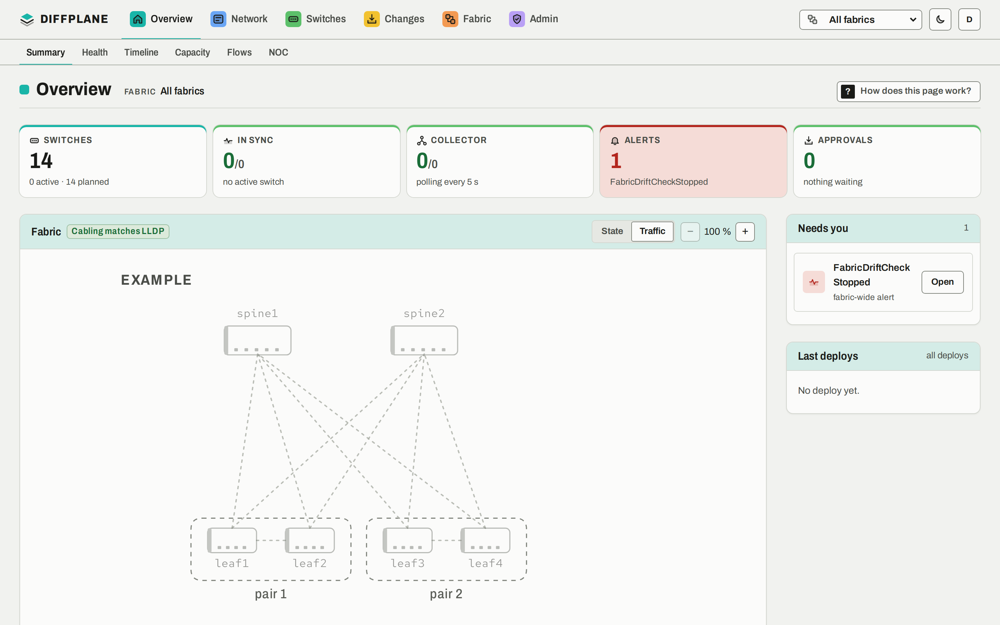

# Diffplane

**An open-source, self-hosted controller for EVPN-VXLAN data-centre fabrics on Huawei CloudEngine
switches.** Describe what you want in a web GUI; Diffplane writes every switch's configuration,
shows you the exact patch, and deploys it only after a person approves it, one safe wave at a
time, checking each switch before going on.

No commercial SDN controller, no licence fee, no cloud: a Docker Compose stack you run yourself,
built on [NetBox](https://github.com/netbox-community/netbox) and
[Annet](https://github.com/annetutil/annet).



## Try it in one command

```sh
git clone https://github.com/razers211/Diffplane.git && cd Diffplane
scripts/demo.sh
```

You need Docker with Compose v2 and Python 3. The script builds and starts the stack, loads two
example fabrics and prints a sign-in. Open <https://127.0.0.1:8000/> (a self-signed certificate:
the script prints its fingerprint). Nothing in the demo talks to a switch: every example switch
is planned, and deploys are off.

Then try the main loop: **Network › Segments**, create a segment and attach it to a leaf port;
**Changes › Pending** shows the patch each switch would get. `scripts/demo.sh down` stops it,
`scripts/demo.sh reset` deletes its data.

## Why

Running an EVPN fabric by hand means typing the same VXLAN, VPN-instance and BGP blocks on every
switch, and keeping route targets, VNIs and addresses consistent across all of them. Diffplane
keeps only the intent (this segment on these ports, routed through that firewall) and derives
everything else, so the switches cannot disagree.

- **Never a change without a diff.** Generate, diff, show the patch, approve, deploy in waves
  that never touch both switches of an M-LAG pair, verify each switch, continue.
- **Drift is visible.** Every 15 minutes each switch is compared with intent; a hand change shows
  up as a diff.
- **The fabric runs without it.** Diffplane only writes configuration; if it is down, the
  network keeps forwarding.
- **It stays out of your way.** The management interface, its VPN instance and the platform's
  own accounts are never touched; hand-made routing objects are imported, not removed.

## What it does

- **Fabrics:** symmetric (distributed gateways) or centralized (a gateway pair); M-LAG leaf
  pairs, OSPF underlay, iBGP EVPN with route-reflector spines. Build new ones on a map, or import
  a running fabric.
- **Intent:** segments and ports (picked on a drawn front panel), Eth-Trunks, firewall and ISP
  services, routing (BGP peers, policies, prefix lists, static routes) in plain words or expert
  view, IPv6, DHCP relay, microsegmentation, QoS, port protection.
- **Safe change:** approvals with roles, pre-deploy checks, change windows with staged drafts,
  intent rollback, config backups, an audit trail.
- **Seeing the network:** live topology, traffic and capacity forecasts, health scores and a
  timeline, control-plane state, optics, flows, syslog, a "why can't A reach B?" answer, and a
  NOC wall view.
- **Running it:** zero-touch provisioning, software upgrades, Active Directory and RADIUS
  sign-in, alerting, high availability on two servers and a witness.

What exists and what still needs more hardware to verify is in the [roadmap](ROADMAP.md).

## Status

Every generator has been deployed and removed on a real CloudEngine switch, ending with an
empty diff (see [supported switches](docs/supported-switches.md)). Behaviour that needs several
real switches together (M-LAG negotiation, EVPN between leaf pairs, traffic across the fabric)
is not verified yet: the [roadmap](ROADMAP.md) lists it, and help with more hardware is welcome. Diffplane is an independent
project, not affiliated with or endorsed by Huawei.

> **Use at your own risk.** Diffplane changes production network configuration. Test it in a lab
> first, bring real fabrics up diff-only, and read the [security model](docs/security-model.md).

## How it works

```
GUI ─► orchestrator (FastAPI) ─► NetBox (source of truth)
                │
                └─► Annet generators ─► diff / patch ─► approval ─► gnetcli (SSH) ─► switches
switches ─► collector (NETCONF, read-only) ─► Prometheus ─► topology, health, drift
```

More: [architecture](docs/architecture.md), [concepts](docs/concepts.md). To run it for real
(your own admin, then a lab switch), follow the [quick start](docs/quickstart.md).

## Documentation

| | |
|---|---|
| [Quick start](docs/quickstart.md) | run it locally with the example fabric |
| [Architecture](docs/architecture.md) | the components and how they talk |
| [Concepts](docs/concepts.md) | fabrics, segments, services, routing intent, import, deploy waves |
| [Supported switches](docs/supported-switches.md) | models, software, what is verified |
| [Security model](docs/security-model.md) | what protects the switches, secrets, known risks |
| [Operations](docs/operations.md) | users, drift, alerts, backups, onboarding, HA, upgrades |
| [Roadmap](ROADMAP.md) | what exists and what needs verification |

## Security

Diffplane can change every switch it manages, so it is built to refuse rather than guess:

- **Nothing reaches a switch without an approved patch.** Each switch's patch is recomputed just
  before it is sent and must equal the approved one.
- **Deploys are off until an admin allows them** per fabric; new and imported fabrics start
  diff-only.
- **Switches are trusted only by pinned host keys**, compared by a person with the console.
- **The management interface, its VPN instance and the platform's own accounts are never
  managed**, so a bad deploy cannot lock the platform out.
- **People:** server-side sessions, roles from viewer to admin, an audit trail, scrypt
  password hashes, a sign-in throttle, same-origin checks and a strict Content-Security-Policy.
  HTTPS only.
- **Secrets** come from `deploy/.env` (generated, never committed) or write-only settings, and
  are masked in every API answer.

Read the [security model](docs/security-model.md) (with its known risks) before running it near
a real network, and the [security review](SECURITY_REVIEW.md). Report vulnerabilities privately as
described in [SECURITY.md](SECURITY.md).

## Development

```sh
pip install -e '.[test]'
pytest                                  # unit, golden-config and patch tests

cd gui
npm ci
npm run dev        # http://127.0.0.1:5173/ui/, API calls proxied to 127.0.0.1:8000
npx vitest run
```

Golden configs live in `tests/golden/<fabric>/<device>.cfg`; regenerate them with
`UPDATE_GOLDEN=1 pytest tests/generators` and review the diff. Contributor notes are in
[CONTRIBUTING.md](CONTRIBUTING.md).

Without installing anything on the host, run the tests in a throwaway container from the
orchestrator image (from the repository root, after `docker compose build orchestrator` in
`deploy/`):

```sh
scripts/test.sh
```

`pip install -e '.[test]'` on a glibc host uses `pgserver` instead (an embedded PostgreSQL).

## Contributing

See [CONTRIBUTING.md](CONTRIBUTING.md) and the [code of conduct](CODE_OF_CONDUCT.md).

## License and trademarks

Apache License 2.0, see [LICENSE](LICENSE) and [NOTICE](NOTICE); third-party software is listed in
[THIRD_PARTY_LICENSES.md](THIRD_PARTY_LICENSES.md). Huawei, CloudEngine and VRP are trademarks of
Huawei Technologies Co., Ltd., used here only to state compatibility.
